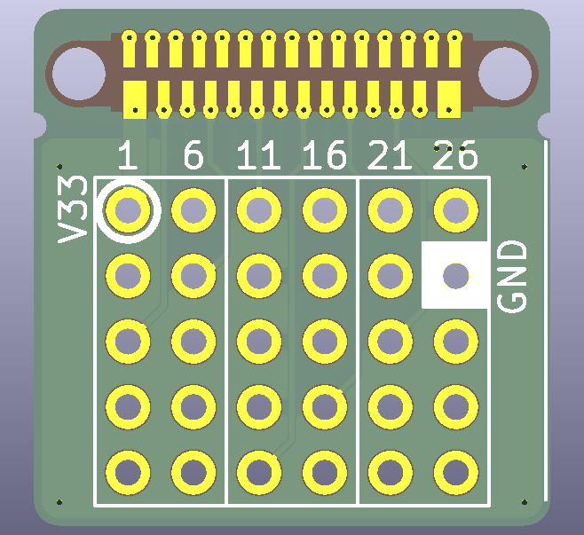
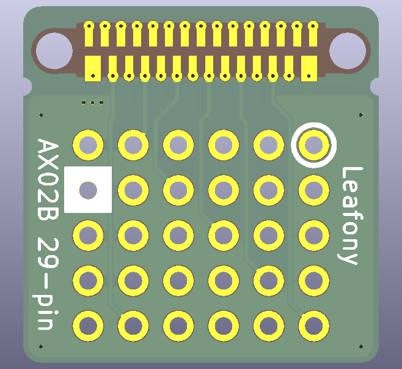

# AX02B 29-pin Leaf

AX02B 29-pin Leafは、Leafony Busの29ピンを2.54mmピッチのスルーホールパッドへ引き出す変換リーフです。ブレッドボード、ユニバーサル基板、ジャンパワイヤ、ピンヘッダを使った試作や信号確認に利用できます。

## 外観

| Top | Bottom |
| --- | --- |
|  |  |

## 特徴

- Leafony Busの29ピンを2.54mmピッチのスルーホールパッドに変換
- Leafony規格の20mm角リーフ形状

## ピン配置

表面シルクの番号は、左上から下方向に5ピンずつ進む配置です。

| 列 | ピン |
| --- | --- |
| 1 | 1, 2, 3, 4, 5 |
| 2 | 6, 7, 8, 9, 10 |
| 3 | 11, 12, 13, 14, 15 |
| 4 | 16, 17, 18, 19, 20 |
| 5 | 21, 22, 23, 24, 25 |
| 6 | 26, 27, 28, 29 |

KiCad回路図上ではLeafony Busの `F1` から `F29` を各スルーホールパッドへ接続しています。

## ファイル構成

```text
.
├── docs/
│   ├── top.png
│   └── bottom.png
└── kicad/ax02-29-pin/
    ├── ax02-29-pin.kicad_pro
    ├── ax02-29-pin.kicad_sch
    ├── ax02-29-pin.kicad_pcb
    └── panelized/
```

## 製造データ

面付け済みデータは `kicad/ax02-29-pin/panelized/Gerber/` にあります。

## 回路図・レイアウトPDF

GitHub Actionsで、`main`へのpush、Pull Request、手動実行時にPDFを生成します。単体基板の `kicad/ax02-29-pin/ax02-29-pin.kicad_sch` と `.kicad_pcb` が対象です。

| 出力 | 内容 |
| --- | --- |
| `schematic.pdf` | 回路図 |
| `layout.pdf` | 表裏・内層の配線4層と表裏シルクを各1ページにした6ページ。各ページに基板外形を表示 |
| `index.html` | PDFへのリンクと生成情報 |
| `build-info.json` | 生成元コミット、KiCad版、生成日時 |

生成物は `output/pdf/` に保存します。PDFをGitへコミットする必要はありません。レイアウトは表面から透視した向きで表示し、裏面も反転しません。閲覧用に4倍に拡大するため、原寸図としては使用しないでください。出力時に必要なゾーンの再計算を行いますが、元の基板ファイルには保存しません。

### ローカルで生成する

KiCad 10のCLI、Git、Python 3を利用できる環境で、リポジトリのルートから実行します。CIでは公式コンテナのKiCad 10.0.8を使用します。

```sh
bash scripts/export-pdfs.sh
```

`kicad-cli`がPATHにない場合は、`KICAD_CLI`で実行ファイルを指定します。macOSの標準インストール先では次のように実行できます。

```sh
KICAD_CLI=/Applications/KiCad/KiCad.app/Contents/MacOS/kicad-cli \
  bash scripts/export-pdfs.sh
```

### CIの生成結果を確認する

GitHubのActionsで対象の実行を開き、Artifactの `kicad-pdfs` をダウンロードします。保持期間は14日です。Pull RequestではPDF生成までを検証し、Pagesへは公開しません。

### GitHub Pagesで公開する

初回に、リポジトリの **Settings → Pages → Build and deployment → Source** を **GitHub Actions** に設定します。その後、`main`へのpushまたは`main`を指定した手動実行で、生成に成功したPDFを公開します。

公開URLはActionsのデプロイ結果で確認してください。組織のカスタムドメイン設定が継承される場合があるため、実際の公開URLを使います。資料サイトからは、そのURLに次のファイル名を付けてリンクします。

- 回路図: `<Pagesの公開URL>/schematic.pdf`
- レイアウト: `<Pagesの公開URL>/layout.pdf`

URLを変えずにPDFが更新されるため、資料サイト側で毎回リンクを変更する必要はありません。公開されるのは直近の生成・公開に成功した版です。生成が失敗した場合は前回の公開版が残るので、Actionsの実行結果と公開ページの生成元コミットを確認してください。
